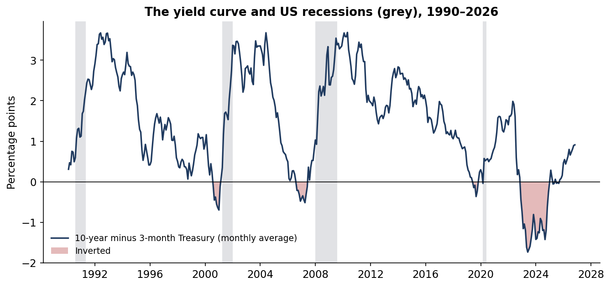
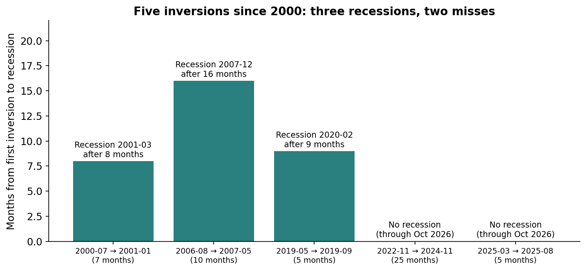
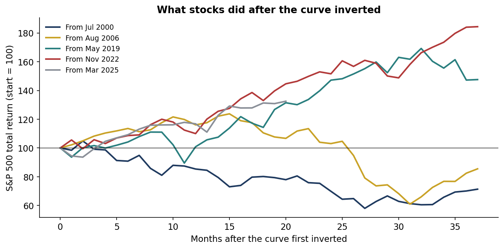
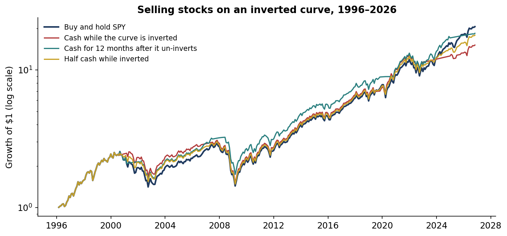

# Does an inverted yield curve still mean recession? Treasury curve 1990–2026, S&P 500 1996–2026

 

**Question.** An inverted yield curve, with short-term Treasury rates above long-term ones, is the most famous recession signal in finance. The curve inverted from late 2022 to late 2024, the deepest and longest inversion in this record. Does the signal still work? Should an investor sell stocks when it fires?

**Answer, on real data.** The measure is the 10-year minus 3-month Treasury yield (monthly average), set against NBER recession dates and S&P 500 (SPY) total returns.

- **Five inversions since 2000; three were followed by recession.** A recession followed in 2001, 2007 and 2020, starting 8, 16 and 9 months after the curve first inverted. The 2020 recession was caused by Covid, not anything the curve foresaw.
- **The deepest inversion was followed by no recession.** From Nov 2022 to Nov 2024 the curve was inverted for 25 months, by up to 1.7 percentage points. No NBER recession followed through the end of the data (Oct 2026). Nor did one follow a shallow 2025 inversion.
- **Stocks often rose after the signal.** From the first inversion to the recession start, the S&P 500 returned −14% (2000), +19% (2006–07) and +11% (2019–20). From Dec 2022 to Dec 2024 it returned +49%, against +11% for T-bills.
- **Selling on inversion cost money.** Switching SPY to T-bills while the curve was inverted earned 9.2% a year from 1996 against 10.3% for buy and hold. That turned $1 into $15.1 instead of $20.6. The worst drawdown was the same (−51%), because the 2008 crash came after the curve had already un-inverted.
- **Waiting for un-inversion did slightly better.** Holding T-bills for the 12 months after the curve turned positive again earned 9.9% a year, with lower volatility and a smaller worst drawdown (−46%). With three useful signals in 30 years, that difference is not reliable.
- **Today.** The curve is positive: +0.91 points (10y−3m) and +0.39 points (10y−2y), October 2026 average.

Full write-up: https://www.guptagaurav.info/articles/does-an-inverted-yield-curve-still-mean-recession

## Results

| Inversion episode (10y−3m, monthly) | Months | Deepest | Recession? | Lead | SPY to recession start | SPY next 12 months | SPY worst drawdown, next 24 months |
|---|---|---|---|---|---|---|---|
| Jul 2000 – Jan 2001 | 7 | −0.70 pp | Mar 2001 | 8 months | −14% | −15% | −33% |
| Aug 2006 – May 2007 | 10 | −0.52 pp | Dec 2007 | 16 months | +19% | +16% | −17% |
| May 2019 – Sep 2019 | 5 | −0.36 pp | Feb 2020 (Covid) | 9 months | +11% | +1% | −19% |
| Nov 2022 – Nov 2024 | 25 | −1.73 pp | None through Oct 2026 | n/a | n/a | +10% | −8% |
| Mar 2025 – Aug 2025 | 5 | −0.06 pp | None through Oct 2026 | n/a | n/a | +17% | −6% |

| SPY vs T-bills, Feb 1996 – Oct 2026 | Return a year | Volatility | Worst drawdown | Sharpe | Time in cash |
|---|---|---|---|---|---|
| Buy and hold SPY | **10.3%** | 15.2% | −50.8% | 0.52 | 0% |
| Cash while the curve is inverted | 9.2% | 14.1% | −50.8% | 0.48 | 14% |
| Cash for 12 months after it un-inverts | 9.9% | 13.8% | **−46.3%** | **0.54** | 15% |
| Half cash while inverted | 9.8% | 14.4% | −50.8% | 0.52 | 7% |

The 10-year minus 2-year spread gives three episodes (2000, 2006–07, 2022–24) and the same conclusion. A probit of "recession in the next 12 months" on the spread, fitted in-sample from 1990 to 2025, has a pseudo-R² of only 0.05. Even a −1.5 point spread maps to just 43%.






## Method

- **Curve.** Daily US Treasury par yields, averaged by month. The main spread is 10-year minus 3-month, the measure behind the NY Fed's recession model. The check spread is 10-year minus 2-year.
- **Episodes.** At least 3 months with a negative monthly-average spread. Inverted months less than 3 months apart are merged.
- **Recessions.** NBER peak-to-trough months. An episode counts as "followed by recession" if one starts within 24 months.
- **Equity and cash.** SPY monthly total return with dividends. Cash earns last month's average 3-month bill yield.
- **Rules.** Each signal is known at month-end and applied to the next month; unit tests check this.
  - Cash while inverted.
  - Cash for 12 months after un-inversion (following at least 3 inverted months).
  - Half cash while inverted.
- **Probit.** In-sample, descriptive only. Four recessions are too few for an out-of-sample test.

## The commercial case

The product is a **macro signal audit**. It tests the indicators an investment committee already watches (yield curve, unemployment rules, PMIs) against the decision they would drive: de-risk or not, and at what cost. It reports hit rates, false alarms and the dollar cost of acting on them.

| Element | Detail (illustrative where stated) |
|---|---|
| Who pays | OCIOs and consultants; pension and endowment CIOs; wealth platforms writing house views; family offices |
| Problem in dollars | On this record, de-risking on inversion turned $1bn into $15.1bn instead of $20.6bn over 30 years. Over Dec 2022 – Dec 2024 alone, cash instead of SPY gave up about $370M per $1bn |
| Product | An indicator scorecard per signal: episodes, lead times, false alarms, decision backtest after costs, current reading |
| Proof | This repository: real data, rules fixed in advance, every number reproducible |
| Build | 3–4 weeks to cover a client's indicator set (one quant) |
| Pricing logic (illustrative) | $20–40k per indicator review, or $75k a year for a quarterly macro-signal monitor |
| Adoption risks | Very few recessions per indicator, so results are fragile and must be presented as evidence, not proof |

## Limits

- **Few events.** Four recessions since 1990 and five inversions since 2000. Every statistic here rests on a handful of cases.
- **Covid.** The 2020 recession was a pandemic shock, so the 2019 inversion's "hit" is partly luck.
- **The 2022–24 miss may not be final.** Recessions are dated with a lag, and the data ends in October 2026.
- **Price data.** SPY starts in 1996 in this source, so the 1989 inversion before the 1990 recession is outside the equity test. The curve data starts in January 1990.
- Independent research on public data. It is not investment advice and has not been deployed.

## Data and citations

Data
- US Treasury daily par yield curve, and SPY daily prices and dividends: via [huggingface.co/datasets/defeatbeta/yahoo-finance-data](https://huggingface.co/datasets/defeatbeta/yahoo-finance-data) (ODC-BY), pinned by sha256 in `configs/default.yaml`.
- US business-cycle peaks and troughs: NBER Business Cycle Dating Committee, [nber.org/research/business-cycle-dating](https://www.nber.org/research/business-cycle-dating).

Methods and related work
- Estrella, A. and Mishkin, F. S. (1998). "Predicting U.S. Recessions: Financial Variables as Leading Indicators." *Review of Economics and Statistics* 80(1), 45–61.
- Estrella, A. and Hardouvelis, G. A. (1991). "The Term Structure as a Predictor of Real Economic Activity." *Journal of Finance* 46(2), 555–576.
- Harvey, C. R. (1988). "The Real Term Structure and Consumption Growth." *Journal of Financial Economics* 22(2), 305–333.
- Federal Reserve Bank of New York, "The Yield Curve as a Leading Indicator" (10-year minus 3-month spread model).

Code, analysis, charts and text were produced with AI assistance (Claude, by Anthropic) and reviewed by Gaurav Gupta.

## Run it

```bash
pip install -r requirements.txt
make all     # verifies the pinned files, runs the study (seconds)
make test
```

Outputs: `reports/metrics.json`, `reports/episodes.csv`, `reports/monthly.csv` and `reports/figures/`. Architecture: [docs/ARCHITECTURE.md](docs/ARCHITECTURE.md).

*Independent research on public data. Not investment advice. Dollar figures are illustrative.*
